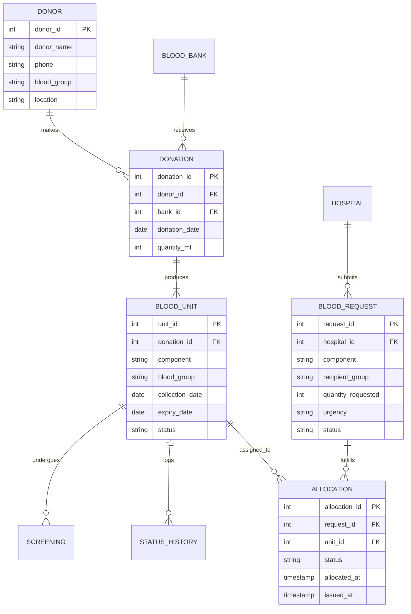

# BloodLink — Academic DBMS Coursework Mapping & Viva Guide

This document maps the **BloodLink Blood Donor Matching & Inventory Management System** directly to the undergraduate Database Management Systems (DBMS) curriculum. It provides theoretical definitions, relational algebra expressions, normalization proofs, SQL code references, and sample viva question-and-answer pairs.

---

## Table of Contents
1. [Unit 1: Introduction to Database Systems](#unit-1-introduction-to-database-systems)
2. [Unit 2: Conceptual Data Modelling (ER Model)](#unit-2-conceptual-data-modelling-er-model)
3. [Unit 3: Relational Data Model & Relational Algebra](#unit-3-relational-data-model--relational-algebra)
4. [Unit 4: SQL & Database Integrity](#unit-4-sql--database-integrity)
5. [Unit 5: Normalization & Functional Dependencies](#unit-5-normalization--functional-dependencies)
6. [Unit 6: Transactions & Concurrency Control](#unit-6-transactions--concurrency-control)
7. [Comprehensive DBMS Viva Preparation Guide](#comprehensive-dbms-viva-preparation-guide)

---

## Unit 1: Introduction to Database Systems

### 1.1 Overview & Architecture
- **Database**: A persistent, logically coherent collection of blood inventory, donor, hospital, and allocation records stored in PostgreSQL.
- **DBMS**: PostgreSQL 18 manages storage, transactional concurrency, referential integrity, and query execution.
- **Three-Tier Client-Server Architecture**:
  1. **Presentation Tier (External)**: Streamlit web interface (`app/main.py`, `pages/*.py`).
  2. **Application / Logic Tier (Conceptual/Logical)**: Python service layer (`services/*.py`) using Psycopg 3 database driver.
  3. **Database Tier (Physical/Internal)**: PostgreSQL relational engine storing tables, constraints, write-ahead logs (WAL), and heap files.

### 1.2 Three-Schema Architecture in BloodLink
| Level | BloodLink Implementation | Purpose |
|---|---|---|
| **External Level (Views / Subschemas)** | SQL Views (`available_blood_inventory`, `blood_request_summary`, `blood_expiry_report`, `allocation_summary`) | Provides customized, secure perspectives for hospital staff and blood bank operators without exposing internal structures. |
| **Conceptual Level (Logical Schema)** | Base table definitions in `database/schema.sql` (10 relational tables) | Describes all entities, attributes, relationships, and constraints independently of physical storage. |
| **Internal Level (Physical Schema)** | PostgreSQL storage layout (PostgreSQL data directory, data pages, sequential heap storage) | Handles byte-level physical data layout, page allocation, and WAL journaling. |

### 1.3 Schema vs. Instance
- **Schema**: The structural blueprint defined at database design time (tables, data types, constraints in `database/schema.sql`). Immutable during regular operations.
- **Instance (State)**: The actual snapshot of data stored in PostgreSQL at any given point in time (e.g., the current count of available units or active requests).

---

## Unit 2: Conceptual Data Modelling (ER Model)

### 2.1 Entity Sets
1. **Regular (Strong) Entities**:
   - `DONOR`: Voluntary blood donors (`donor_id` as primary key).
   - `BLOOD_BANK`: Storage and distribution facilities (`bank_id` as primary key).
   - `HOSPITAL`: Medical institutions requesting blood components (`hospital_id` as primary key).
2. **Dependent / Transactional Entities**:
   - `DONATION`: Collection events linking a donor to a blood bank.
   - `BLOOD_UNIT`: Distinct physical bags of blood/components produced from a donation.
   - `SCREENING`: Lab test results evaluating a blood unit.
   - `BLOOD_REQUEST`: Formal hospital requisitions for blood.
   - `ALLOCATION`: Assignment of specific units to a blood request.
   - `STATUS_HISTORY`: Audit trail capturing state transitions.
   - `BLOOD_COMPATIBILITY`: Matrix defining transfusion compatibility rules.

### 2.2 Attributes
- **Simple / Atomic**: `phone`, `quantity_ml`, `blood_group`, `status`.
- **Key Attributes**: `donor_id`, `bank_id`, `unit_id`, `request_id`, `allocation_id`.
- **Composite Key**: `(component, recipient_group, donor_group)` in `blood_compatibility`.
- **Derived Attribute**: `days_until_expiry` (calculated dynamically as `expiry_date - CURRENT_DATE`).

### 2.3 Cardinalities & Relationship Types
- **Donor to Donation** ($1 : N$): One donor can make multiple donations over time; each donation belongs to exactly one donor.
- **Blood Bank to Donation** ($1 : N$): One blood bank oversees many donations; each donation occurs at one blood bank.
- **Donation to Blood Unit** ($1 : N$): One donation can be separated into components (whole blood, red cells, plasma, platelets).
- **Blood Unit to Screening** ($1 : N$): Each unit can have one or more screening records (e.g., initial test, re-test).
- **Hospital to Blood Request** ($1 : N$): One hospital can place multiple blood requests.
- **Blood Request to Blood Unit** ($M : N$ via `ALLOCATION`): One request can require multiple units; units are allocated to requests via the `allocation` associative entity.

### 2.4 ER Diagram (Mermaid)



---

## Unit 3: Relational Data Model & Relational Algebra

### 3.1 Relational Schemas & Keys
- **Candidate Key**: A minimal superkey uniquely identifying a tuple (e.g., `phone` in `DONOR`, `unit_id` in `BLOOD_UNIT`).
- **Primary Key (PK)**: The chosen candidate key (e.g., `donor_id`, `unit_id`).
- **Foreign Key (FK)**: An attribute matching the primary key of another relation:
  - `donation.donor_id` $\to$ `donor.donor_id`
  - `blood_unit.donation_id` $\to$ `donation.donation_id`
  - `allocation.unit_id` $\to$ `blood_unit.unit_id`
  - `allocation.request_id` $\to$ `blood_request.request_id`

### 3.2 Relational Algebra Expressions

#### Expression 1: Filter Available O+ Red Cell Units
$$\pi_{\text{unit\_id, expiry\_date}} \left( \sigma_{\text{status} = \text{'available'} \land \text{blood\_group} = \text{'O+'} \land \text{component} = \text{'red\_cells'}} (\text{BLOOD\_UNIT}) \right)$$

#### Expression 2: Donors Who Never Donated (Set Difference $-$)
$$\pi_{\text{donor\_id}}(\text{DONOR}) - \pi_{\text{donor\_id}}(\text{DONATION})$$

#### Expression 3: Union of Healthcare Contact Points (Set Union $\cup$)
$$\pi_{\text{bank\_name, phone}}(\text{BLOOD\_BANK}) \cup \pi_{\text{hospital\_name, phone}}(\text{HOSPITAL})$$

#### Expression 4: Natural Join for Allocation Details ($\bowtie$)
$$\pi_{\text{request\_id, hospital\_name, unit\_id}} \left( \text{BLOOD\_REQUEST} \bowtie \text{HOSPITAL} \bowtie \text{ALLOCATION} \right)$$

---

## Unit 4: SQL & Database Integrity

### 4.1 SQL DDL (Data Definition Language)
- **Table Creation**: `CREATE TABLE` with explicit data types (`VARCHAR`, `INT`, `DATE`, `TIMESTAMP`).
- **Sequence Generation**: `GENERATED ALWAYS AS IDENTITY` ensures PostgreSQL controls sequential surrogate primary keys.
- **Constraint Definition**: `ALTER TABLE ... ADD CONSTRAINT` in `database/constraints.sql`.

### 4.2 Database Constraints
1. **NOT NULL Constraint**: Enforced on mandatory columns (`donor_name`, `phone`, `blood_group`).
2. **CHECK Constraints**:
   - Discrete Domain Check:
     ```sql
     CHECK (blood_group IN ('A+', 'A-', 'B+', 'B-', 'AB+', 'AB-', 'O+', 'O-'))
     ```
   - Range Check:
     ```sql
     CHECK (quantity_ml BETWEEN 50 AND 600)
     ```
   - Temporal Consistency Check:
     ```sql
     CHECK (expiry_date > collection_date)
     ```
3. **UNIQUE Constraint**:
   ```sql
   ALTER TABLE donor ADD CONSTRAINT uq_donor_phone UNIQUE (phone);
   ```
4. **Referential Integrity Constraints (Foreign Keys)**:
   - Enforces valid parents: No orphan blood units, donations, or allocations.

### 4.3 Three-Valued Logic in SQL
In SQL, comparisons with `NULL` evaluate to `UNKNOWN` rather than `TRUE` or `FALSE`.
- **`IS NULL` vs. `= NULL`**:
  - `location IS NULL` correctly evaluates to `TRUE` if location is empty.
  - In `status_history`: `CHECK (old_status IS NULL OR old_status IN (...))` demonstrates handling initial record states using three-valued logic.

### 4.4 Advanced Retrieval Queries Implemented
1. **Multi-Table Joins**: 5-table relational join in [`services/reports_service.py`](file:///c:/Users/SANTOSH/OneDrive/Desktop/BloodLink/services/reports_service.py):
   ```sql
   FROM allocation AS a
   JOIN blood_request AS br ON br.request_id = a.request_id
   JOIN hospital      AS h  ON h.hospital_id = br.hospital_id
   JOIN blood_unit    AS bu ON bu.unit_id     = a.unit_id
   JOIN donation      AS d  ON d.donation_id  = bu.donation_id
   JOIN blood_bank    AS bb ON bb.bank_id     = d.bank_id
   ```
2. **Correlated Subqueries with `EXISTS`**:
   Used in `available_blood_inventory` view to verify that the latest screening is approved:
   ```sql
   WHERE EXISTS (
       SELECT 1 FROM screening s
       WHERE s.unit_id = bu.unit_id AND s.result = 'approved'
         AND NOT EXISTS (
             SELECT 1 FROM screening newer
             WHERE newer.unit_id = s.unit_id AND newer.screening_date > s.screening_date
         )
   )
   ```
3. **Set Operations**:
   - **`UNION`**: Combines blood banks and hospitals into a directory ([`database/reports.sql`](file:///c:/Users/SANTOSH/OneDrive/Desktop/BloodLink/database/reports.sql) Report 5).
   - **`EXCEPT`**: Finds registered donors with zero donations ([`database/reports.sql`](file:///c:/Users/SANTOSH/OneDrive/Desktop/BloodLink/database/reports.sql) Report 6).
4. **Aggregation & Grouping with `HAVING`**:
   Filter aggregated blood banks with stock greater than or equal to the average stock ([`database/reports.sql`](file:///c:/Users/SANTOSH/OneDrive/Desktop/BloodLink/database/reports.sql) Report 7).
5. **Views**: Four persistent database views providing logical data independence.

---

## Unit 5: Normalization & Functional Dependencies

### 5.1 Functional Dependencies (FDs)
- **`DONOR`**:
  $$\text{donor\_id} \to \{\text{donor\_name, phone, blood\_group, location}\}$$
  $$\text{phone} \to \{\text{donor\_id, donor\_name, blood\_group, location}\}$$
- **`HOSPITAL`**:
  $$\text{hospital\_id} \to \{\text{hospital\_name, address, phone}\}$$
- **`DONATION`**:
  $$\text{donation\_id} \to \{\text{donor\_id, bank\_id, donation\_date, quantity\_ml}\}$$
- **`BLOOD_UNIT`**:
  $$\text{unit\_id} \to \{\text{donation\_id, component, blood\_group, collection\_date, expiry\_date, status}\}$$
- **`BLOOD_REQUEST`**:
  $$\text{request\_id} \to \{\text{hospital\_id, component, recipient\_group, quantity\_requested, urgency, request\_date, status}\}$$
- **`ALLOCATION`**:
  $$\text{allocation\_id} \to \{\text{request\_id, unit\_id, status, allocated\_at, issued\_at, cancelled\_at}\}$$

### 5.2 Normal Form Proofs

#### First Normal Form (1NF)
- **Condition**: All attributes contain only atomic (indivisible) values, and there are no repeating groups.
- **Proof**: In all tables, each attribute (e.g., `phone`, `blood_group`, `status`) contains a single atomic scalar value. No comma-separated strings or nested arrays exist.

#### Second Normal Form (2NF)
- **Condition**: The relation is in 1NF and contains **no partial dependencies** (no non-prime attribute is functionally dependent on a proper subset of any candidate key).
- **Proof**: 
  - In all entity tables (`donor`, `hospital`, `donation`, `blood_unit`, `blood_request`, `allocation`), the primary keys are single-attribute surrogate keys (`donor_id`, etc.). Therefore, partial key dependencies are mathematically impossible.
  - In `blood_compatibility`, the primary key is composite `(component, recipient_group, donor_group)`. There are no non-prime attributes in this relation; hence 2NF is satisfied.

#### Third Normal Form (3NF)
- **Condition**: The relation is in 2NF and contains **no transitive dependencies** ($X \to Y$ and $Y \to Z$ where $Z$ is non-prime and $Y$ is not a superkey).
- **Proof by Design**:
  - Suppose hospital information were stored directly inside `blood_request`. Then:
    $$\text{request\_id} \to \text{hospital\_id} \quad \text{and} \quad \text{hospital\_id} \to \text{hospital\_name}$$
    This would create a transitive dependency $\text{request\_id} \to \text{hospital\_name}$.
  - BloodLink avoids this by decomposing into `HOSPITAL` and `BLOOD_REQUEST`, where `blood_request` stores only the foreign key `hospital_id`. Hence, every non-trivial functional dependency $X \to A$ has $X$ as a superkey.

#### Boyce-Codd Normal Form (BCNF)
- **Condition**: For every non-trivial functional dependency $X \to A$, $X$ must be a superkey.
- **Proof**: In every table in BloodLink, the left-hand side of every functional dependency is a superkey (`donor_id`, `unit_id`, `request_id`, etc.). Therefore, the database is in **BCNF**.

### 5.3 Lossless Join Decomposition
When reconstructing hospital requests with hospital details:
$$\text{BLOOD\_REQUEST} \bowtie_{\text{hospital\_id}} \text{HOSPITAL}$$
Because $\text{BLOOD\_REQUEST} \cap \text{HOSPITAL} = \{\text{hospital\_id}\}$, and `hospital_id` is the primary key (superkey) of `HOSPITAL`, by relational decomposition theorem, the join is guaranteed to be **lossless** (no spurious tuples are generated).

---

## Unit 6: Transactions & Concurrency Control

### 6.1 ACID Properties in BloodLink
| Property | Principle | BloodLink Demonstration in Allocation Workflow |
|---|---|---|
| **Atomicity** | All-or-Nothing execution | In [`services/allocation_service.py`](file:///c:/Users/SANTOSH/OneDrive/Desktop/BloodLink/services/allocation_service.py), unit reservation, allocation insertion, status history logging, and request updates are executed in a single transaction block. If an error occurs, `conn.rollback()` restores the initial state. |
| **Consistency** | Invariants preserved across states | Database moves from one valid state to another. Constraints (`CHECK`, `FOREIGN KEY`, `UNIQUE`) are verified before the transaction commits. |
| **Isolation** | Intermediate states invisible to concurrent sessions | Concurrent users running emergency search or allocating units cannot see partially reserved units until `conn.commit()` succeeds. |
| **Durability** | Committed data survives power failure | PostgreSQL Write-Ahead Logging (WAL) ensures committed transactions are permanently persisted on disk. |

### 6.2 Two-Phase Locking (2PL) for Concurrency Control
To prevent lost updates, dirty reads, and duplicate allocations under concurrent transactions, BloodLink employs **Two-Phase Locking (2PL)**:

```mermaid
sequenceDiagram
    autonumber
    actor Admin1 as Session 1 (Nurse A)
    actor Admin2 as Session 2 (Nurse B)
    participant DB as PostgreSQL Database

    Note over DB: Unit #10 is 'available'

    Admin1->>DB: BEGIN TRANSACTION
    Admin1->>DB: SELECT unit_id FROM available_blood_inventory WHERE unit_id = 10 FOR UPDATE SKIP LOCKED
    Note over DB: Lock Acquired by Session 1 (Growing Phase)

    Admin2->>DB: BEGIN TRANSACTION
    Admin2->>DB: SELECT unit_id FROM available_blood_inventory WHERE unit_id = 10 FOR UPDATE SKIP LOCKED
    Note over DB: SKIP LOCKED detects lock; excludes Unit #10 for Session 2!

    Admin1->>DB: UPDATE blood_unit SET status = 'reserved' WHERE unit_id = 10
    Admin1->>DB: INSERT INTO allocation (request_id, unit_id, status) VALUES (1, 10, 'reserved')
    Admin1->>DB: COMMIT
    Note over DB: Locks Released (Shrinking Phase)

    Admin2->>DB: (Session 2 safely allocates Unit #11 instead - No Duplicate Allocation!)
```

1. **Growing Phase**: Locks are acquired via `SELECT ... FOR UPDATE SKIP LOCKED` inside the transaction. No locks are released during this phase.
2. **Shrinking Phase**: When `conn.commit()` or `conn.rollback()` is invoked at the end of the transaction, all acquired locks are released simultaneously.
- **Guarantee**: Rigorous Strict 2PL produces conflict-serializable schedules and eliminates deadlocks by skipping locked rows (`SKIP LOCKED`).

---

## Comprehensive DBMS Viva Preparation Guide

### Sample Questions & Answers for Viva Examination

#### Q1: "What data model does BloodLink use?"
> *"BloodLink uses the **Relational Data Model**, where data is organized into tables (relations) of rows (tuples) and columns (attributes), interconnected through foreign key references."*

#### Q2: "Can you explain the Three-Schema Architecture in your project?"
> *"Yes. The **Internal Schema** is PostgreSQL's disk storage format and WAL files. The **Conceptual Schema** comprises our 10 base tables and constraints defined in `schema.sql`. The **External Schema** consists of the 4 views (like `available_blood_inventory`) and Streamlit screens tailored for specific user tasks."*

#### Q3: "Why did you create a separate `DONATION` table instead of storing donor data in `BLOOD_UNIT`?"
> *"To adhere to **Second and Third Normal Forms (2NF & 3NF)**. One donor can make multiple donations over time, and one donation can produce multiple components (red cells, plasma, platelets). Storing donor information inside `blood_unit` would cause data redundancy and partial dependencies on the donation event."*

#### Q4: "Show me where you used Set Operations in your project."
> *"In [`database/reports.sql`](file:///c:/Users/SANTOSH/OneDrive/Desktop/BloodLink/database/reports.sql) and the Reports page under the DBMS Showcase tab:
> 1. **`UNION`** combines blood banks and hospitals into a single directory of medical contact points.
> 2. **`EXCEPT`** performs set difference to identify registered donors who have not yet participated in any donation events."*

#### Q5: "What is Three-Valued Logic and how does your project handle it?"
> *"In SQL, conditions evaluate to `TRUE`, `FALSE`, or `UNKNOWN` due to `NULL` values. In our schema, optional columns like `donor.location` and `status_history.old_status` can be `NULL`. Queries explicitly use `IS NULL` / `IS NOT NULL` and `COALESCE` rather than equality operators to prevent unexpected `UNKNOWN` evaluations."*

#### Q6: "How do you guarantee that two users don't allocate the same blood unit at the same second?"
> *"We use **Two-Phase Locking (2PL)** with database transactions. In [`services/allocation_service.py`](file:///c:/Users/SANTOSH/OneDrive/Desktop/BloodLink/services/allocation_service.py), candidate units are queried using `SELECT ... FOR UPDATE SKIP LOCKED`. This locks the row at the PostgreSQL storage engine level. If another session tries to reserve the same unit, it skips it or fails an atomic update condition (`WHERE status = 'available'`), triggering `conn.rollback()`."*

#### Q7: "What Normal Form is your database in?"
> *"The schema is in **Boyce-Codd Normal Form (BCNF)**. All attributes are atomic (1NF), there are no partial key dependencies (2NF), no transitive dependencies (3NF), and for every non-trivial functional dependency $X \to Y$, the determinant $X$ is a superkey (BCNF)."*

